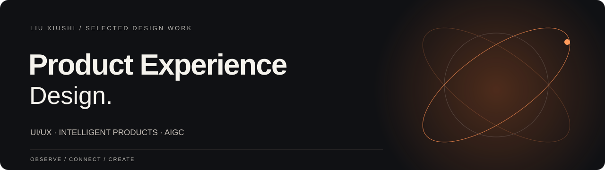
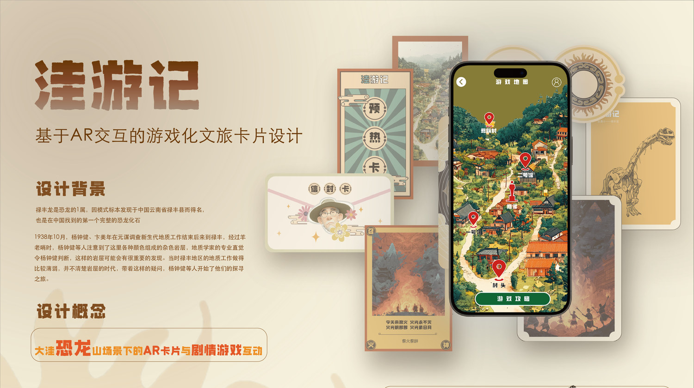

<a href="#selected-work">设计作品</a>　/　<a href="#aigc-and-narrative">生成式创作</a>　/　<a href="#research">设计研究</a>　/　<a href="#contact">联系</a>

# 刘修世 Liu Xiushi

**产品体验设计 · UI/UX · 智能产品 · 设计研究**

我关注产品如何融入真实的生活场景：从使用者的任务出发，梳理实体产品、数字界面与服务触点之间的关系。这里收录了三个产品体验项目、两个数字叙事项目，以及两篇已发表的设计研究论文。

 

## 01—03 / 产品体验设计

<table>
<tr>
<td width="55%" valign="top"></td>
<td width="45%" valign="middle">
01　/　FEATURED PROJECT
<h2>WORKFIT</h2>

<b>办公室健康助手</b>

我围绕久坐办公中的短时放松与运动，设计穿戴设备、收纳方式和 App 交互。完整案例包含体验地图、产品结构、界面流程与实物演示。

<a href="workfit.md">阅读设计案例 ↗</a> <a href="workfit-design-process.pdf">完整设计说明</a>　·　<a href="workfit-product-film.mp4">实物视频</a>

</td>
</tr>
</table>

<table>
<tr>
<td width="50%" valign="top">

02　/　SERVICE EXPERIENCE
<h3>AIRSHARING · 爱享食</h3>

我将食物分享拆解为认证、投放、领取与反馈，让设备、App 和参与者形成连续的服务流程。

<a href="airsharing.md">阅读设计案例 ↗</a>

</td>
<td width="50%" valign="top">

03　/　INTELLIGENT PRODUCT
<h3>AIRKEEP · 智能健身组件</h3>

我以小型居住空间为场景，设计可组合的训练器械、集中收纳结构与配套 App。

<a href="airkeep.md">阅读设计案例 ↗</a>　·　<a href="airkeep-product-film.mp4">产品视频</a>

</td>
</tr>
</table>

 

## 04 / 生成式创作与数字叙事

<table>
<tr>
<td width="50%" valign="top">

04A　/　AIGC FILM
<h3>阿诗玛：时空回响</h3>

我将剧本、角色、分镜、动态生成与剪辑串成创作流程，并记录提示词、画面迭代和最终影像。

<a href="ashima-aigc.md">阅读创作过程 ↗</a>　·　<a href="ashima-aigc-film.mp4">观看成片</a>

</td>
<td width="50%" valign="top">

04B　/　INTERACTIVE NARRATIVE
<h3>洼游记</h3>

我把地方文化线索转化为角色、卡片与移动端任务，探索实体媒介和数字叙事的连接方式。

<a href="wayouji.md">阅读设计案例 ↗</a>　·　<a href="wayouji-design-process.pdf">完整设计过程</a>

</td>
</tr>
</table>

 

## 05 / 设计研究

我的研究聚焦文化资源的数字化表达，以及用户与社区如何参与设计。以下两篇论文均已发表，可阅读原文。

**AI赋能农业遗产地数字文旅创新路径研究——以紫鹊界梯田为例**  
《产业创新研究》2026(14): 55–57 · 第一作者  
我从遗产地资源、游客评价和文旅服务触点出发，讨论数字体验与内容传播的设计路径。  
[论文全文 ↗](paper-ziqujie-2026.pdf)

**数智时代下云南非遗手工艺创新设计研究——基于CiteSpace的文献可视化分析**  
《艺术与设计（理论）》2026(07): 117–119 · 第一作者  
我用 CiteSpace 梳理研究线索，并讨论用户与社区参与非遗数字化设计的方式。  
[论文全文 ↗](paper-ich-citespace-2026.pdf)　·　[研究方法与引文](research.md)

 

## 联系

**邮箱**　[1204864876@qq.com](mailto:1204864876@qq.com)  
**小红书 ID**　743319063

DESIGN / RESEARCH / EVERYDAY EXPERIENCE
