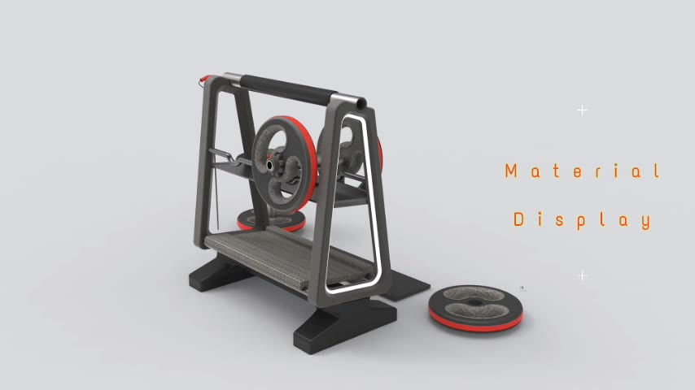
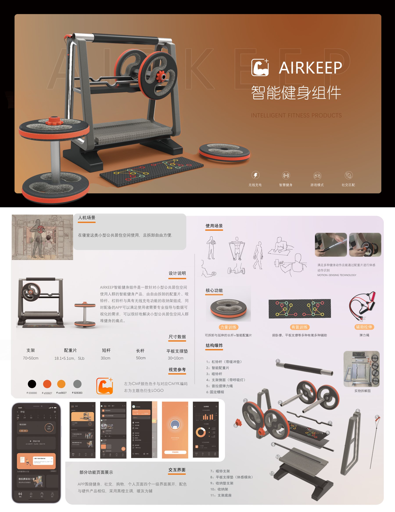

[← 返回个人主页](https://github.com/Chrisliu316)

# AIRKEEP｜智能健身组件

## 产品与界面演示

[查看 AIRKEEP 产品展示视频 · MP4](airkeep-product-film.mp4)

我用视频展示产品旋转、组件细节、材质和 App 页面。视频用于表达产品动画与界面方案。

## 场景与设计方向

我以寝室等小型公共居住空间为场景，设计可拆卸的健身组件及配套 App，重点处理训练方式、日常收纳和数字端反馈之间的关系。

## 组件与体验

| 部分 | 方案内容 |
| :-- | :-- |
| 训练组件 | 配重片、哑铃杆、杠铃杆、支撑垫与弹力绳 |
| 收纳结构 | 支架与组件收纳关系 |
| 智能反馈 | 动作识别、无线充电与训练记录相关设计 |
| 配套 App | 计划、健身、社交、购物及个人页面 |

## 关键设计关注

- **空间适配**：我用可拆卸结构和集中收纳减少器械占用空间。
- **多种训练**：我尝试用组件组合支持力量、有氧与辅助拉伸任务。
- **数字辅助**：我让 App 承接训练计划、指导和记录展示。

## 作品展示

## 设计思考：有限空间如何容纳多种训练？

我把组件组合与收纳作为同一个系统来设计。下一步需要测试器械是否容易拆装、收纳，以及使用者能否理解 App 中的动作反馈和计划记录。

*目前展示的是设计方案，我尚未对硬件功能和服务效果给出实测结论。*

---

[联系我](mailto:1204864876@qq.com) · [返回精选作品](https://github.com/Chrisliu316#精选作品)
