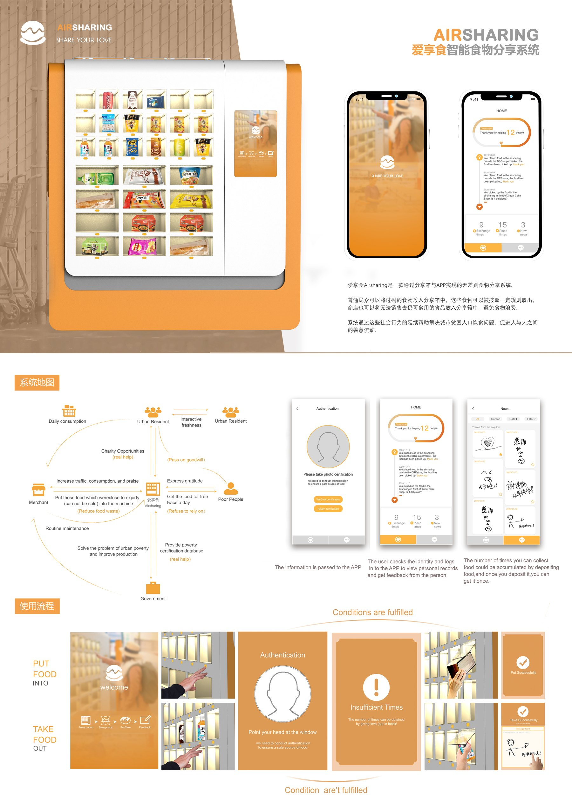

[← 返回个人主页](https://github.com/Chrisliu316)

# AIRSHARING｜爱享食智能食物分享系统

## 场景与设计方向

我设计分享箱与 App 的协同流程，连接食物投放者、领取者和设备维护方，让可分享的食物有明确的投放与领取路径。

## 服务触点

| 参与方 | 方案中的关系 |
| :-- | :-- |
| 居民与商户 | 将可分享食物放入分享箱 |
| 领取者 | 通过身份认证与领取规则获取食物 |
| 设备与 App | 连接认证、存取、记录与反馈 |
| 维护与管理方 | 支持日常维护及相关资格信息 |

## 核心任务

**身份认证 → 投放或领取 → 操作反馈 → 记录与感谢**

我在展板中分别呈现操作条件满足与不满足时的提示，使领取资格与设备操作之间的关系可见。

## 作品展示

## 设计判断

我把投放者、领取者和维护方放在同一服务流程中，让认证、存取和反馈前后衔接。针对领取条件不满足的情形，我在界面中加入明确提示，帮助使用者理解当前状态和后续操作。

---

[联系我](mailto:1204864876@qq.com) · [返回精选作品](https://github.com/Chrisliu316#精选作品)
