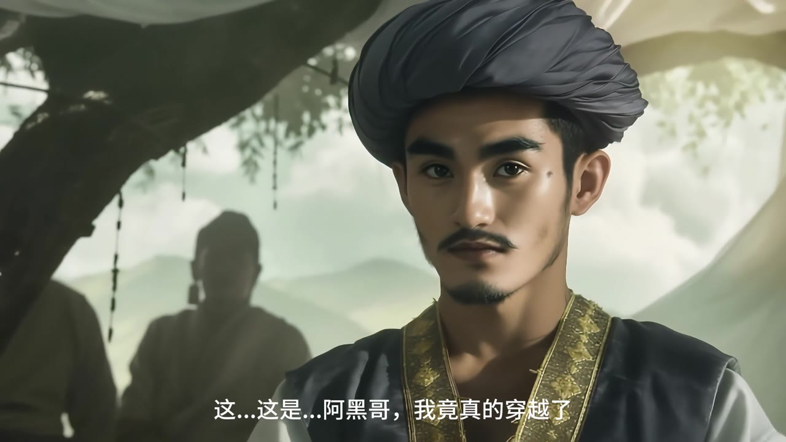

[← 返回个人主页](https://github.com/Chrisliu316)

# 阿诗玛：时空回响

**AIGC 内容创作实践 / 数字叙事**

我以云南文化叙事为主题，将创作拆分为剧本、角色、分镜、动态影像和后期制作几个环节，并保留各阶段材料供对照。

## 成片与完整创作记录

[观看／下载成片 · MP4](ashima-aigc-film.mp4) · [完整创作过程 · 33页 PDF](ashima-creation-process.pdf) · [角色生成记录 · 14页 PDF](ashima-character-development.pdf)

我的最终成片约3分钟。创作过程保留了剧本、提示词、角色设定和分镜记录。

### 创作方法

我把剧本、角色、分镜、动态生成和剪辑分成不同任务，逐步确定人物形象和镜头节奏。我对照角色设定与成片，调整面部、服饰、画面衔接和故事连续性。

## 创作流程

**文本构思 → 角色与分镜生成 → 一致性调整 → 动态生成 → 剪辑与声音**

| 环节 | 创作过程材料中使用的工具 |
| :-- | :-- |
| 文本与剧本构思 | ChatGPT |
| 分镜提示词与故事板探索 | DALL·E |
| 角色设定、提示词与一致性控制 | Midjourney |
| 动态影像生成 | Runway |
| 后期剪辑与音效 | 剪映 |

## 01 / 剧本构思、分镜提示词与角色设定

## 02 / 角色形象、提示词与多视角参考

我用多视角参考统一角色形象，并记录提示词与各版本变化。

## 03 / 剧情画面与制作记录

## 设计思考：生成之后，还需要哪些判断？

这次实践中，我先分别处理文本、角色和镜头，再进入动态生成与后期制作。我重点检查角色在不同镜头中是否容易辨认、画面是否推动剧情，以及文化元素是否与具体情境相符。

我用提示词、参考图和多视角探索调整角色形象，再通过剪辑与声音安排建立镜头之间的叙事关系。

---

[联系我](mailto:1204864876@qq.com) · [返回精选作品](https://github.com/Chrisliu316#精选作品)
