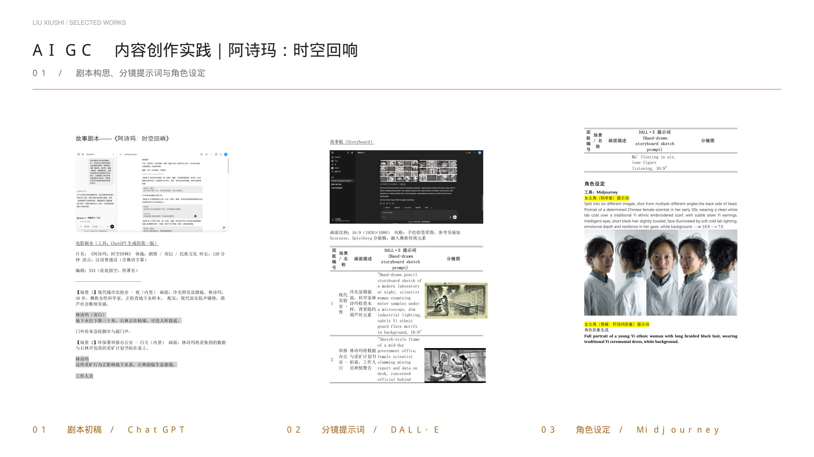
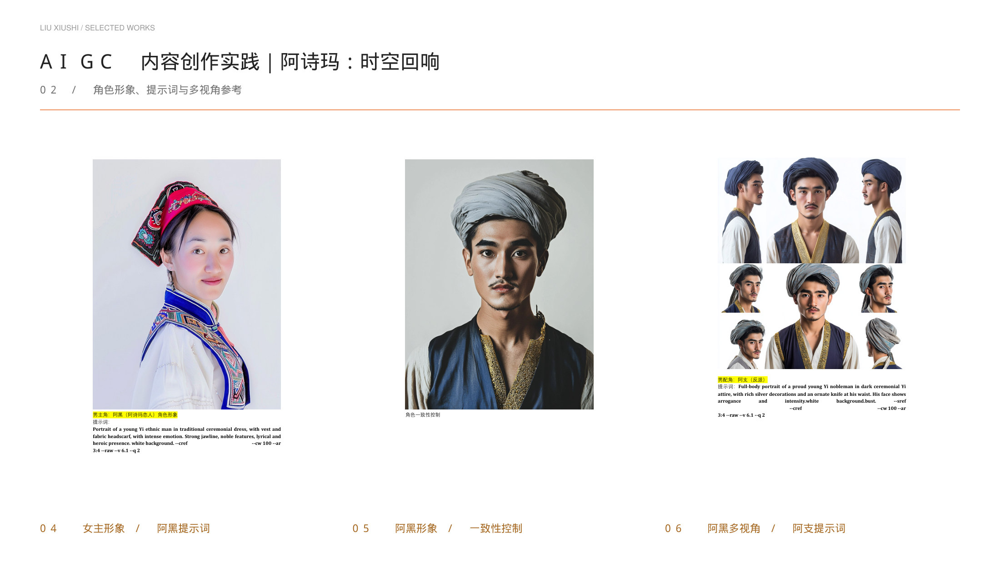
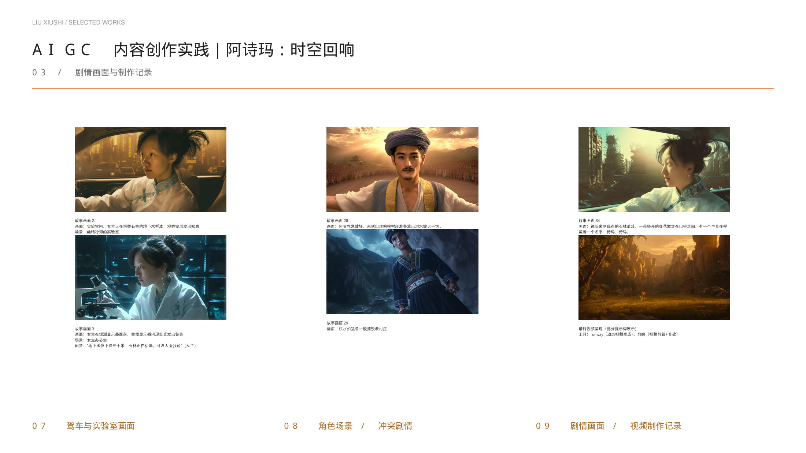

[← 返回个人主页](https://github.com/Chrisliu316)

# 阿诗玛：时空回响

**AIGC 内容创作实践 / 数字叙事**

以云南文化叙事为主题，记录从剧本、角色与分镜到动态影像和后期制作的创作过程。

## 创作流程

**文本构思 → 角色与分镜生成 → 一致性调整 → 动态生成 → 剪辑与声音**

| 环节 | 创作过程材料中使用的工具 |
| :-- | :-- |
| 文本与剧本构思 | ChatGPT |
| 分镜提示词与故事板探索 | DALL·E |
| 角色设定、提示词与一致性控制 | Midjourney |
| 动态影像生成 | Runway |
| 后期剪辑与音效 | 剪映 |

## 01 / 剧本构思、分镜提示词与角色设定

## 02 / 角色形象、提示词与多视角参考

这一组选页记录角色形象、提示词与参考参数。页面内的角色图与不同角色提示词分别保留，便于追溯生成过程。

## 03 / 剧情画面与制作记录

## 设计思考：生成之后，还需要哪些判断？

这次实践将文本、角色和镜头拆成不同的生成任务，再进入动态生成与后期。需要持续检查的是：角色在不同镜头中是否保持辨识度，画面是否服务剧情，以及文化元素是否与故事情境相符。

创作记录展示了提示词、参考图与多视角探索；角色一致性是需要反复调整的目标，不能仅凭一组生成图就视为已解决。

以上为创作过程选页，展示工具的实际使用环节。

---

[联系我](mailto:1204864876@qq.com) · [返回精选作品](https://github.com/Chrisliu316#精选作品)
