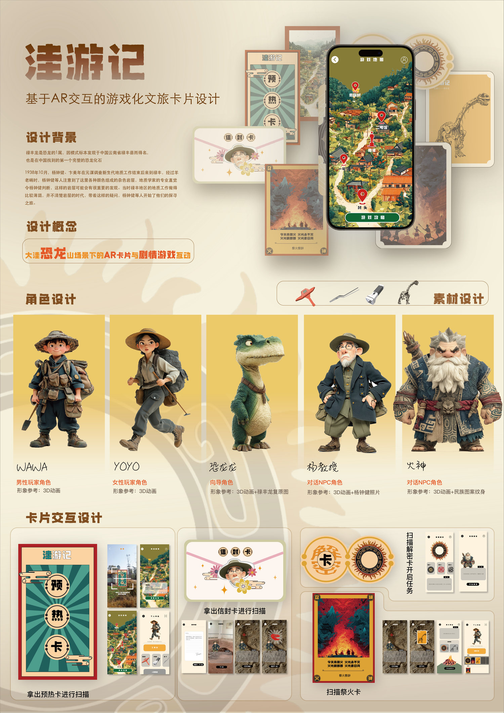
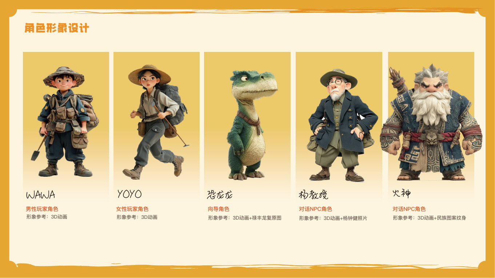
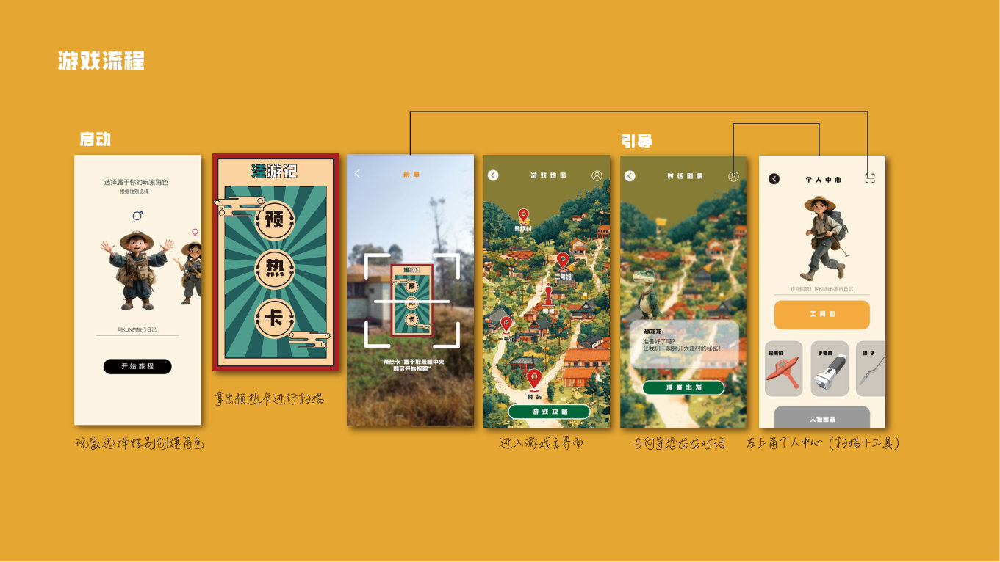
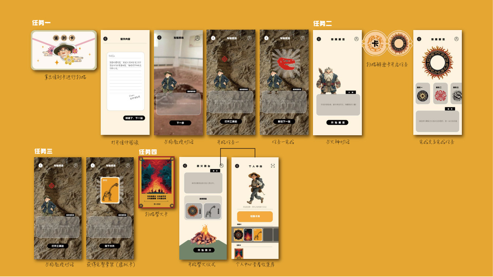

[← 返回个人主页](https://github.com/Chrisliu316)

# 洼游记｜大洼村数字文旅交互概念

**文化元素梳理 / 角色与卡片设计 / AR 任务流程**

我以云南禄丰大洼村为主题，尝试把恐龙化石线索和地方文化元素组织成一套可探索的卡片与移动端体验。作品呈现角色、实体与数字卡片、界面方案和分章节任务；AR 扫描与剧情互动属于设计构想。

[查看完整设计过程 · 12页 PDF](wayouji-design-process.pdf)

## 我如何组织内容

我先整理禄丰龙、杨钟健及相关发现线索，以及彝族村落、太阳纹与火文化等参考资料，再选择适合进入故事和视觉系统的元素。过程文件第2—4页记录了这一阶段的资料与元素梳理；其中的历史、古生物及文化表述沿用原方案，正式发布前仍需逐项核验来源。

## 从角色和卡片进入任务

在视觉方案中，我设计了玩家角色、向导恐龙和对话角色，并将预热卡、信件卡、解密卡等安排到不同任务节点。卡片既是视觉载体，也承担“扫描—获取线索—进入下一步”的交互入口。过程文件第5—9页展示概念、卡片、界面与角色设计。

## 交互流程

我把体验拆为启动引导、扫描卡片、进入地图、与角色对话、收集线索和解锁后续任务。过程文件第10—11页展示界面与任务顺序，第12页是对话文本草案。

## 我会继续验证什么

目前的材料能说明内容组织与交互构想，尚不能证明 AR 识别、现场导览或任务完成率已经实现并验证。如果继续推进，我会先检验首次使用者是否理解卡片之间的关系、如何找到下一张卡，以及扫描失败时是否知道如何继续。

我将这个项目放在“AIGC 辅助设计”分类下，重点展示视觉探索与数字叙事方案。原始过程文件没有完整记录生成工具、提示词版本或人工修改的逐步对照，因此这里不把角色图像称为可复现的 AIGC 工作流，也不标注未经证实的工具和效率数据。

---

[联系我](mailto:1204864876@qq.com) · [返回精选作品](https://github.com/Chrisliu316#精选作品)
