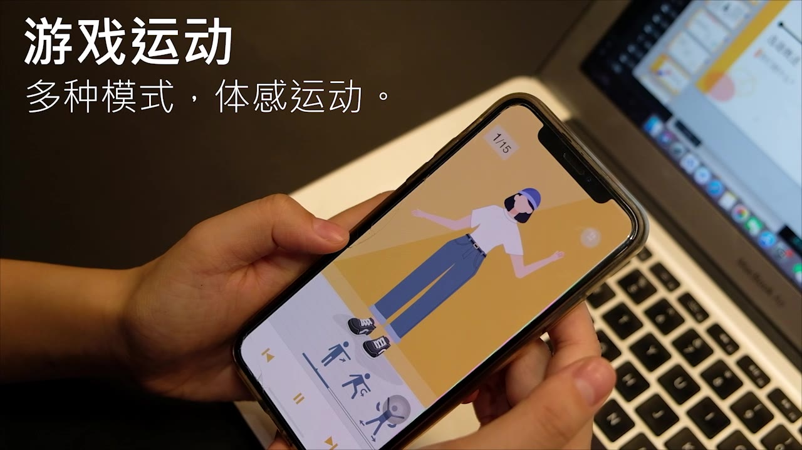

[← 返回个人主页](https://github.com/Chrisliu316)

# WORKFIT｜办公室健康助手

## 从说明到演示

[完整设计说明 · 28页 PDF](workfit-design-process.pdf) · [交互录屏 · MP4](workfit-interaction-demo.mp4) · [实物与产品展示 · MP4](workfit-product-film.mp4)

作品视频呈现实物使用、界面操作及产品表达；交互录屏可单独查看。视频展示的是样机与方案演示，不据此推定所有感知、健康监测或激励功能已完成工程验证。

### 设计过程阅读索引

| 设计环节 | 完整说明中的位置 |
| :-- | :-- |
| 场景背景与希望点提取 | 第2—6页 |
| 5W2H分析、目标用户与需求 | 第7—10页、第12—15页 |
| 用户体验地图 | 第11页 |
| 系统地图与功能技术预设 | 第16—18页 |
| 草图、效果、结构与使用场景 | 第19—23页 |
| 信息架构与低保真 | 第24—25页 |
| 交互流程与高保真 | 第26—27页 |

原稿中的体验地图、用户细分与功能预设用于表达设计分析。它们与实际访谈、问卷、可用性测试的记录属于不同证据，页面不补造调研样本或产品成效。

## 场景与设计方向

项目面向办公室久坐人群，将按摩放松、运动与记录结合起来。设计材料包含软硬件方案、服务系统地图、硬件结构及 App 界面。

## 产品与数字端如何连接

| 触点 | 方案内容 |
| :-- | :-- |
| 穿戴设备 | 腕带固定、心率检测、运动检测及按摩相关组件 |
| 收纳与充电 | 设备收纳、充电底座与凝胶片收纳 |
| App | 运动记录与总结、商城、游戏化运动、健康提醒与规划 |

## 使用链路

- **进入场景**：以办公环境下的放松与运动需求作为起点。
- **参与运动**：利用游戏与社交机制增加运动的参与方式。
- **反馈与持续使用**：通过可视化记录、提醒和总结连接单次使用与日常习惯。

## 作品展示

产品、服务关系、硬件结构与 App 界面见下方展板。

## 设计思考：怎样把放松与运动放进办公日常？

WORKFIT 的讨论起点是办公室里的身体体验。设备承担放松与感知功能，App 承接记录、提醒和游戏化运动；两者之间的联系，是阅读这个方案时的重点。设计进一步需要回答：使用者何时愿意戴上设备、怎样理解反馈，以及何种提醒不会打断工作。

*项目以设计方案展示，硬件功能与服务效果尚不作实测结论。*

---

[联系我](mailto:1204864876@qq.com) · [返回精选作品](https://github.com/Chrisliu316#精选作品)
